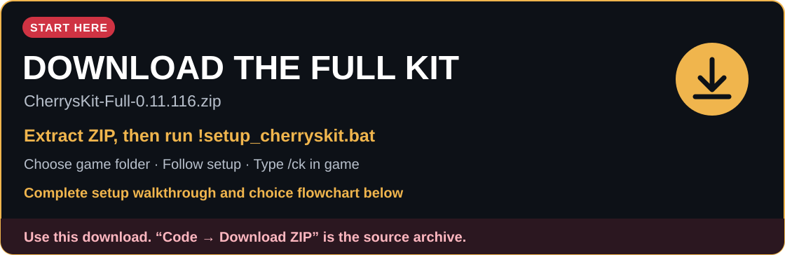

[](https://github.com/Cherrybooze/Cherrys-Kit/releases/download/v0.11.115/CherrysKit-Full-0.11.115.zip)

# Cherry's Kit

> Playtest build: kit **0.11.115**. Native-client checks are listed in [TESTING.md](docs/TESTING.md). The [latest stable build](https://github.com/Cherrybooze/Cherrys-Kit/releases/latest) is available separately.

## [Download the full kit — install ZIP](https://github.com/Cherrybooze/Cherrys-Kit/releases/download/v0.11.115/CherrysKit-Full-0.11.115.zip)

**Extract this ZIP straight into your game's `Interface/AddOns/` folder.** It creates `Interface/AddOns/CherrysKit/CherrysKit.toc`. Then double-click **`!setup_cherryskit.bat`**, which lands next to the `CherrysKit` folder, start the game or Reload UI, and type `/ck`.

> **What the setup does:** it says which addons are out of date against the latest release here on GitHub and can update them, checks what your addons can use and asks before installing what's missing, moves older copies of the kit's addons to `Interface\offloaded_addons` so the kit's versions win (nothing is deleted), stops the Global Bank helper during updates, puts LogNextChar's login screen in place, and walks you through the optional Chrome extension. It asks at most five questions. Run the same file whenever you want to update.

> **Installing the addon? Use the download above.** GitHub's green **Code → Download ZIP** button and **Source code (zip)** links download the repository, with an extra `Cherrys-Kit-main` or version folder. Those downloads are for working on the source.

**Runes of Magic addons that work together, with one small control hub.**

Current playtest build: **0.11.115** · [Release notes and all downloads](https://github.com/Cherrybooze/Cherrys-Kit/releases/tag/v0.11.115)

Cherry's Kit combines original addons, rewrites and fixes to older favourites into a single collection: chat, bags and the shared bank view, an auction house, tooltips, one-key rotations, on-screen bars and displays, a quest tracker, and a replacement login screen. Pick the full kit, or install the hub and the addons you want. The hub opens their settings, turns them on or off after Reload UI, and gives them one place on your minimap.

## What's new in 0.11.115

- **Cherry's Info 1.0** (`/cinfo`, `/cq`) replaces **Cherry's Quests**, **pbInfo**, **TooltipIds**, **PortraitHP** and **Extended Macro Icons**: one addon, one switch in `/ck` and one window with four tabs. Your saved settings carry over, and their commands still work.
- **LogNextChar 1.3.1** now includes Cherry's Loginxml: one addon, one ZIP, with its login screen inside. Its installer moves old folders to `Interface\offloaded_addons` instead of deleting them, and copies your old `loginxml` there first when anything would change.
- **The guided setup** (`!setup_cherryskit.bat`, in the Full and Hub ZIPs) for installs and updates. It tells you which addons are out of date against GitHub and updates them for you, with the old versions kept. It knows hub-only installs, so your own copy of an addon only moves when the kit's copy is there to replace it.
- **Global Bank 1.5.7** has a refreshed in-game window: server tabs, characters grouped by account, and a search that lights up the matching bag and bank slots.
- **Lighter and smaller.** Cherry's Grid 1.1.6 makes next to no garbage while drawing: in a simulated 36-member raid, about 580 KB of new memory a second fell to almost nothing. The XML files of Cherry's Grid, Cherry's Chat, zBag and Global Bank went from 598, 401, 229 and 561 KB to 105, 70, 123 and 113 KB, with the same frames, so the game has less to read at login.
- **Global Bank 1.4.16** keeps same-named characters on different servers apart, on its page, in its window and on the character screen.
- **Global Bank Daily Rewards 1.2.5** for Chrome: the page is built for thousands of characters, with a Region button, server checkmarks (Ayvenas included), a Servers tab to edit them, one selection on every tab, the game's tooltips with item and mana stone stats, stacking checkmarks per item type, Always stack, a Favourites tab, RoM account names, and an item menu that stacks the characters who hold it. Collecting the daily reward automatically is now a tick in the popup, off by default. A dark and gold popup with a live helper badge, and **Stop** also unticks automatic startup. The helper no longer stops after three minutes on its own: the extension's heartbeat now really runs. Already have the extension? Press **Reload** on it, and that's all.
- **Ultimate Mail Mod 7.0.1-ck11**: on **Mass Send Items**, the recipient picker shows History, Characters and Friends.

## In 0.11.114

- **Global Bank's helper lives with Chrome.** Tick **Keep the helper running automatically when Chrome is open** and it ends on its own when Chrome, or the extension, goes away. The extension's button shows whether it is running and for how long, has a **Stop Global Bank helper** button, and a **Show its terminal window** tick if you want to watch it.
- **The game's own tooltips on the Global Bank page.** Gear and mana stones hover with the tooltip the game shows, saved when a character logs out.
- **Whole accounts at once.** Logging in one character through LogNextChar's login screen records its account's character list: their servers are filled in, and they're boxed together under Link characters and on the gold heatmap, names in class colours.
- **Mouse 4 in Cherry's Grid 1.1.5.** It joins the click buttons on your frames, with Shift, Ctrl and Alt, and a tick on the Clicks page, off by default, also makes it a game keybind over windows and buttons.

## Since 0.11.101

- **Global Bank 1.4.8 to 1.4.14** and its Chrome extension turn the extension's page into a full bank viewer: one scrolling grid with the game's own icons, search (also by stat, on items or mana stones), filters and exclusions, plus **Currencies**, **Stats**, **Gold heatmap**, **Characters**, **Item Depot** and **Gameforge accounts** tabs. Accounts are encrypted with your own password and stay on your PC. Gear never stacks, auctions leave the cache when they end, and the Bank tab can read your folders without the helper.
- **LogNextChar's login screen and buttons**: each character's gold and last save on the character screen, the helper's status on the server screen, and the mailbox closes before switching characters.
- **Cherry's Chat 0.11.0**: emoji in `/say` go out as symbols the game font can draw, or as `:code:` text when there is no symbol, so the speech bubble over your head no longer shows empty boxes. Pick the style with **Say bubbles** in `/cchat`.
- **Cherry's Bar 1.1.9**: Location can show your coordinates, with a tick in its right-click menu or in `/cbar`.
- **Real time for addons** (0.11.101): the hub has a clock, fed by the Chrome extension when Chrome starts, and Cherry's Bar's Clock and ZShop's daily reminder use it.

Older changes are in each addon's guide and in the [release notes](https://github.com/Cherrybooze/Cherrys-Kit/releases). Some features still need confirmation in the game client; the guides say which.

## Why this project exists

Runes of Magic has plenty of useful addons, but many were made years ago and have different interfaces, overlapping features or rough edges on the current client. This project brings the addons I use into one place, fixes problems I run into, and connects them where it helps: raid-frame clicks can run a KittyCombo rotation, and rom weakauras can display what that rotation will do next.

It is a personal hobby project, shared so other players can use it, learn from it and improve it. It is not a promise to maintain every old addon or support every client and server setup.

## Download and install

**[Download the full-kit install ZIP](https://github.com/Cherrybooze/Cherrys-Kit/releases/download/v0.11.115/CherrysKit-Full-0.11.115.zip)** · [Hub and individual addon downloads](https://github.com/Cherrybooze/Cherrys-Kit/releases/tag/v0.11.115)

- **Full kit:** the install ZIP above includes the hub and every addon.
- **Choose your addons:** download the Hub ZIP and whichever addon ZIPs you want from the release assets. Updating one addon? Update the hub too.
- **Updating:** double-click `!setup_cherryskit.bat` in `Interface/AddOns/`. [It finds and installs what's out of date](#keeping-addons-updateable). Don't have that file yet (0.11.114 or older)? Extract the Full or Hub ZIP over your `Interface/AddOns/` once, then run it.

Extract the selected ZIPs into your game's **`Interface/AddOns/`** folder. They all contain a top-level `CherrysKit/` folder: merge those folders, keeping `CherrysKit.toc` directly inside `CherrysKit/`. Start the game or Reload UI, then type **`/ck`** (or **`/rwa`**).

The resulting layout should be:

```text
Interface/
  AddOns/
    CherrysKit/
      CherrysKit.toc
      CherrysKit.lua
      KittyCombo/
      RomWeakAuras/
      ...
```

If you already downloaded `Cherrys-Kit-main.zip`, use the install ZIP linked above instead. If Windows offers an extraction folder named after the ZIP, change that destination to your existing `Interface/AddOns/` folder. If it's already extracted that way inside `AddOns`, run the setup from there: it installs the kit properly and moves that extra folder out, because the game would otherwise load both.

Old separate copies of the same addons: **`!setup_cherryskit.bat`** moves them to `Interface\offloaded_addons`, but only for addons the kit's copy is installed for. Until one is moved, the hub keeps its own copy of that addon off and says which folder takes precedence. Your saved settings live outside the addon folders. The [hub README](Interface/AddOns/CherrysKit/README.md) explains this in more detail, and the [addon map](docs/ADDON_MAP.md) lists what each addon works with.

**Addon LoadTimes** is a troubleshooting addon with its own ZIP. It comes switched off in its `LoadTimes/Switch.txt` and then uses no memory. Every individual addon ZIP requires the hub.

## What's included

| Addon | What it does | Command | Version |
| --- | --- | --- | --- |
| [Cherry's Kit hub](Interface/AddOns/CherrysKit/README.md) | Shared settings launcher, on/off switches, minimap button and a clock for other addons. | `/ck`,`/rwa` | 0.4.28 |
| [Cherry's KittyCombo](Interface/AddOns/CherrysKit/KittyCombo/README.md) | One-key priority combos and shared rotation codes. | `/kc` | 1.7.18 |
| [rom weakauras](Interface/AddOns/CherrysKit/RomWeakAuras/README.md) | Custom buff, debuff, cooldown, cast and status displays, with short share codes. | `/wa` | 0.9.31 |
| [Cherry's Chat](Interface/AddOns/CherrysKit/CherrysChat/README.md) | Selectable chat, copying, emoji, encrypted channels and chat display settings. | `/cchat` | 0.11.1 |
| [zBag](Interface/AddOns/CherrysKit/zBag/README.md) | Bags, searching, sorting, quick sell and an All bags view. | `/zb` | 5.07-ck17 |
| [Global Bank](Interface/AddOns/CherrysKit/GlobalBank/README.md) | A searchable view of your characters' bags, banks and gold, in game and in Chrome. | `/gb` | 1.5.7 |
| [Ultimate Mail Mod](Interface/AddOns/CherrysKit/UltimateMailMod/README.md) | Mail management, drag-box selection, shared recipients, gold presets and mass sending. | `/umm` | 7.0.1-ck11 |
| [Advanced AuctionHouse](Interface/AddOns/CherrysKit/AdvancedAuctionHouse/README.md) | Auction searching, stat filters, Broad search, history and a resizable window. | `/aah` | 6.2.5 |
| [Cherry's Addon LoadTimes](Interface/AddOns/CherrysKit/LoadTimes/README.md) | Troubleshooting: loading times and memory use, off until its Switch.txt turns it on. | `/ckload` | 1.3.0 |
| [ZShop](Interface/AddOns/CherrysKit/ZShop/README.md) | Item-shop access and a daily loyalty reward shortcut. | `/zshop` | 1.2.0-ck5 |
| [Cherry's Info](Interface/AddOns/CherrysKit/CherrysInfo/README.md) | Quest tracker with Ctrl+click NPCs, richer tooltips with IDs, target health on its portrait, chat filters and 10,500+ macro icons. | `/cinfo`,`/cq` | 1.0.3 |
| [Cherry's Grid](Interface/AddOns/CherrysKit/CherrysGrid/README.md) | Party and raid frames, with KittyCombo actions on click and Mouse 4. | `/grid` | 1.1.6 |
| [Cherry's Bar](Interface/AddOns/CherrysKit/CherrysBar/README.md) | Information bars at the top, bottom or both, with displays set per bar. | `/cbar` | 1.1.9 |

Some integrations need both addons: for example, running a kitty from Grid needs KittyCombo. Each addon's README lists its requirements and current limits. Features still being tested are labelled there.

## Separate packages

This one isn't in the full kit: extract it into `Interface/AddOns/` as usual. It needs the hub, goes into `CherrysKit\` and loads through it like any kit addon.

| Package | What it does | Command | Version |
| --- | --- | --- | --- |
| [LogNextChar](Interface/AddOns/LogNextChar/README.md) | Next and Prev buttons that log you straight into the neighbouring character, with its own login screen: gets past a stuck server list, saved logins, keyboard controls, and each character's gold with Global Bank. The guided setup puts the login screen in place, or run its `Install login screen.bat` once. | `/lnc` | 1.3.1 |

Download it from this build: [LogNextChar-1.3.1.zip](https://github.com/Cherrybooze/Cherrys-Kit/releases/download/v0.11.115/LogNextChar-1.3.1.zip).

## Optional Chrome extension

[Download Global Bank Daily Rewards for Chrome 1.2.5](https://github.com/Cherrybooze/Cherrys-Kit/releases/download/v0.11.115/CherrysKit-GlobalBankDailyRewards-1.2.5.zip): an optional, separate Windows package for Chrome, for Global Bank. Its page shows every character's bank in one grid, with currencies, stats, a gold heatmap, the item depot, encrypted Gameforge accounts and the helper's terminal and auction cache. It records daily rewards when the Gameforge daily shop page confirms them, can collect them for you if you tick that in its popup, can keep the helper running while Chrome is open, and tells the kit the time.

Extract the extension ZIP into `Interface/AddOns/`, run **Install Chrome extension.bat** from `CherrysKit/GlobalBank/Helper/`, and follow the [step-by-step setup guide](extras/GlobalBankDailyRewards/README.md). Chrome requires a one-time **Load unpacked** step, and after that an update only needs **Reload** on the extension. Automatic page processing is limited to the Gameforge daily shop and item depot pages; the extension does not send your local data to the developer.

## Keeping addons updateable

**Players:** double-click **`!setup_cherryskit.bat`** in `Interface/AddOns/`, or right-click **`!setup_cherryskit.ps1`** beside it and choose **Run with PowerShell**. The window opens at once, and within a couple of seconds says which addons are out of date against the release marked Latest here. Say yes and it downloads only those, checks each file against the release's checksums, moves the old versions to `Interface\offloaded_addons` and puts the new ones in place, keeping any changes you made to `Commands.lua`. It also lists what your addons can use that isn't there, such as Chrome for Global Bank's extension or an addon yours works with, and asks yes or no before installing any of it. All it contacts is this repository's release files, with no account, and `-NoUpdateCheck` turns that off. Press **Reload** on the Chrome extension afterwards if Global Bank changed.

**Developers:** the tool only works while every addon and release keeps to these rules. A change that breaks one isn't ready to merge.

1. **One folder per addon**, at `Interface/AddOns/CherrysKit/<Folder>`, listed in `release-packages.json` and loaded through `CherrysKit.toc`. No `.toc` of its own: the game loads every `.toc` it finds under `AddOns`.
2. **A version line near the top of its README**, `Version **x** · ...`, in the first 12 lines and equal to its version in `release-packages.json`. That line is what the setup compares. A test fails when they differ.
3. **A new version for every changed addon.** Change the files and keep the number, and players never get the change. The hub follows the same rule, and every release gets a new `kit_version`, in `CherrysKit.toc` too.
4. **No player data in addon folders.** An update moves the old folder away. Settings go in saved variables. A file players edit by hand, like `Commands.lua`, must be on the setup's `$script:KeepOnUpdate` list.
5. **Say what a rename or merge replaces.** Take the old folder's lines out of `CherrysKit.toc`, so the setup moves it out, and list the old folders under `origin.others` in `release-packages.json`, so the new addon comes in for whoever had the old one.
6. **ZIPs hold only `CherrysKit/...`**, plus the two launchers at the root of the Full and Hub ZIPs. The builder checks this, and the setup refuses anything else.
7. **A release is tagged `v<kit version>`, carries every ZIP, `release-versions.json`, `release-manifest.json` and `SHA256SUMS.txt`, and is marked Latest.** The setup only offers the release marked Latest, so a prerelease reaches testers by its link and not through the tool. Never replace a published ZIP's files.
8. **Try the update before publishing:** build, then run `Setup-CherrysKit.ps1 -ReleaseFolder dist\<kit version>` in a copy of a game folder. Add `-ReinstallAll` to reinstall packages whose version didn't change.
9. **Say what an addon can use.** The setup's Dependencies step offers the `works_with` addons in `release-packages.json` to anyone who has the addon naming them. A Windows program an addon needs goes in the setup's `Get-Dependencies`.

[The release guide](docs/RELEASING.md) has the steps in order.

## Support and pull requests

Support and PR reviews are **best effort**. This is a small personal project; there is no promised response time, release schedule, or guarantee that every request will be taken on.

**Feel free to tweak it for your own setup.** If you think you fixed something that was broken, open a pull request. Keep it focused, explain what was wrong and what changed, and include what you tested in game. **Ideally DM me, cherry, on the Runes of Magic Discord about it too**, I may not notice a GitHub notification quickly.

Bug reports are welcome as well: say which addon and kit version you use, what you expected, what happened, and how to reproduce it. Add relevant probe output or screenshots when useful; the addon README gives the exact command. See [CONTRIBUTING.md](CONTRIBUTING.md) for a short guide.

## Inside this repository

- [`Interface/AddOns/CherrysKit/`](Interface/AddOns/CherrysKit/) holds the installed addon tree, with a README in the hub and every addon folder. LogNextChar sits beside it, in [`Interface/AddOns/LogNextChar/`](Interface/AddOns/LogNextChar/), with the login screen itself in [`Interface/loginxml/`](Interface/loginxml/).
- [`docs/curseforge/`](docs/curseforge/README.md) contains the copy-and-paste CurseForge descriptions and publishing notes.
- [`docs/ADDON_MAP.md`](docs/ADDON_MAP.md) lists what each addon works with, and [`docs/TESTING.md`](docs/TESTING.md) the checks that need the real game client.
- [`docs/RELEASING.md`](docs/RELEASING.md) explains packaging, installation layouts and publishing a version.
- [`release-packages.json`](release-packages.json) records the package names, versions and links between addons.
- [`tools/build_release.py`](tools/build_release.py) creates the ZIPs, validates their contents and writes SHA-256 checksums, and [`tools/curseforge_pages.py`](tools/curseforge_pages.py) keeps the descriptions' requirement lines in step with `release-packages.json`.

All addon source lives on **`main`**. Use short-lived branches for changes and tags for releases. Generated ZIPs live in Releases rather than Git history.

## Development and checks

Python 3.10 or later is enough to build; there are no Python package dependencies:

```sh
python tools/build_release.py
```

This creates sixteen ZIPs in `dist/<kit version>/` (the full kit, the hub, twelve addons, LogNextChar and the optional Chrome extension), plus a release manifest, checksums and release notes. The same check runs on pushes and pull requests. It verifies the packaged source, file references, archive structure and local documentation links.

The tests run the addons on Lua 5.1 against a simulated client: install `tests/requirements.txt`, then run `python -m unittest discover -s tests -p 'test_*.py' -v`. Native drawing, input, sound and event timing still need in-game checks, listed in [TESTING.md](docs/TESTING.md).

## Credits and licences

This collection includes work by several addon authors and bundles several different licences. Keep the individual credits, notices and media licences with anything you redistribute. [LICENSE.txt](LICENSE.txt) preserves the original combined notice file; the package READMEs explain the relevant origins, and each addon ZIP includes a copy.

The original [0.11.77 bundle README](docs/reference/CherrysKit_README-0.11.77.txt) is retained for reference.
