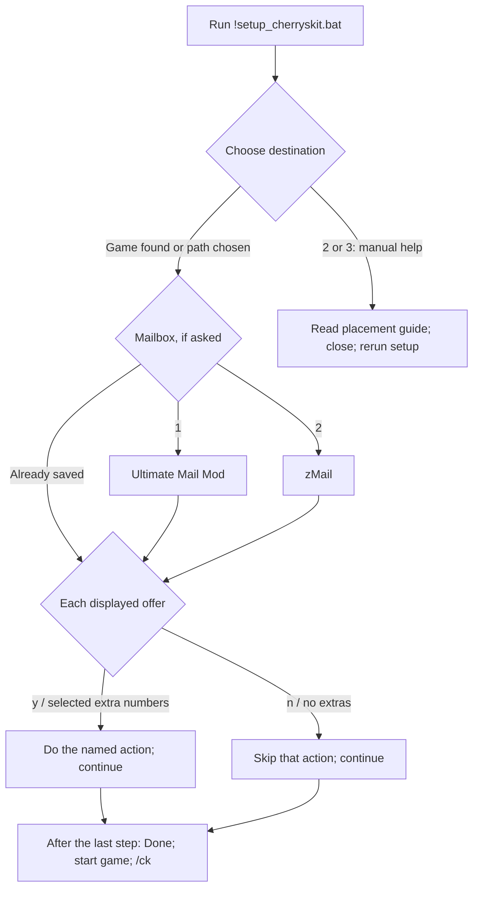

[](https://github.com/Cherrybooze/Cherrys-Kit/releases/download/v0.11.117/CherrysKit-Full-0.11.117.zip)

**[Read the setup walkthrough and flowchart ↓](#guided-setup-every-prompt)**

# Cherry's Kit

**Runes of Magic addons that work together, with one small control hub.**

Cherry's Kit combines original addons, rewrites and fixes to older favourites: one-key rotations, custom combat displays, chat, bags, mail, auctions, raid frames, information bars, tooltips and a quest tracker. Global Bank adds a view across your characters in game and, optionally, in Chrome. LogNextChar is a separate download for switching characters and replacing the login screen.

Pick the full kit, or install the hub and just the addons you want. Type **`/ck`** to open their settings from one window, switch kit addons on or off after Reload UI, and keep one button on your minimap. Every kit addon works with the hub alone; installing other addons adds the connections described below.

> **Current release: 0.11.117.** The downloads below contain the latest hub, addons and Chrome extension. Setup and the Addons page check the release marked [Latest](https://github.com/Cherrybooze/Cherrys-Kit/releases/latest). Features still needing native-client confirmation are listed in [TESTING.md](docs/TESTING.md).

### Install or update in four steps

1. **Choose your download.** Use the full-kit button above, or get the **Hub** ZIP and the addon ZIPs you want from the [release page](https://github.com/Cherrybooze/Cherrys-Kit/releases/tag/v0.11.117). [Compare the packages](#download-and-install) and [see what each addon does](#whats-included).
2. **Close the game and extract the ZIPs.** Downloads is fine; your game's `Interface\AddOns\` is fine too. Let Windows merge their `CherrysKit` folders. The Full and Hub ZIPs put **`!setup_cherryskit.bat`** beside that folder. Keep them together.
3. **Double-click `!setup_cherryskit.bat`.** Select your game folder if asked, choose a mailbox addon on first setup, and review updates, optional extras and older addon copies. The [prompt-by-prompt walkthrough and flowchart](#guided-setup-every-prompt) explain the inputs and their results. Chrome has a few [one-time steps of its own](#first-installation-in-chrome).
4. **Start the game and type `/ck`.** Open the settings of the addons you installed. Later, close the game and rerun the same setup file to update, or use [Addons in the Chrome extension](#manage-addons-from-chrome).

**Already using CurseForge?** Pick the addons you want; the app installs the hub with them. Run the guided setup afterwards to deal with old separate copies, LogNextChar's login screen or Chrome. **Already on 0.11.114 or older?** Extract a current Full or Hub ZIP once to get the setup launchers.

**On this page:** [Addon descriptions](#whats-included) · [Downloads and folder layout](#download-and-install) · [Setup choices](#guided-setup-every-prompt) · [Chrome installation and updates](#optional-chrome-extension) · [Update, offload and restore in Chrome](#manage-addons-from-chrome) · [Troubleshooting](#common-questions) · [Recent changes](#whats-new-in-011117)

## Coming in the next release

- **Addons page updates run as administrator** (Global Bank 1.6.5): Windows asks for permission first, so a game folder such as `C:\RunesOfMagic` no longer stops an update with *Access is denied*. Declining changes nothing. Replaced addons leave the list once they're gone, a **Login screen** panel shows whether `Interface\loginxml` is in place, and the Offload/Delete buttons line up with the table rows.
- **Clearer popup** (extension 1.3.5): **Run automatically while Chrome is open** says that it starts the helper in the background instead of a visible terminal window.

## What's new in 0.11.117

- **All current packages are published together**, so the setup and Chrome Addons page can offer the latest versions. Advanced AuctionHouse **6.2.6** and Addon LoadTimes **1.3.1** give their refreshed documentation new package versions while preserving the older published files.

- **Clearer update versions** (Global Bank 1.6.4, extension 1.3.4): the hub row compares hub versions, and **Latest release** refers to the published release rather than GitHub's source branch. A matching hub no longer appears outdated because the ZIP has the kit's version number.
- **Reload is a separate step:** install updated files first, then use **Reload extension** and refresh an already open Global Bank tab. Reload does not download merged PR changes. The popup and Addons page explain this directly.

## What's new in 0.11.116

- **Stats in the game's colours** (Global Bank 1.6.3, Chrome extension 1.3.3): the stat name and its effects appear on the same row using the saved tooltip colours. Characters in **Who has them** use their tooltip's class colour.
- **Exclude stats:** right-click a stat and choose **Exclude this stat from showing**. Open **Excluded stats** on the same page to restore one or all of them. This only filters the Stats page and is saved locally in this Chrome profile.
- **Private data stays outside the kit:** release checks reject private mail, tooltip, account-vault, terminal and backup files, including copied/temporary files and linked folders. Steam and Gameforge on the same PC still use the same local character data; that data is never part of a download or source archive.

<details>
<summary><strong>Recent changes: 0.11.115 and earlier</strong></summary>

## What's new in 0.11.115

- **Cherry's Info 1.0** (`/cinfo`, `/cq`) replaces **Cherry's Quests**, **pbInfo**, **TooltipIds**, **PortraitHP** and **Extended Macro Icons**: one addon, one switch in `/ck` and one window with four tabs. Your saved settings carry over, and their commands still work.
- **LogNextChar 1.3.3** now includes Cherry's Loginxml: one addon, one ZIP, with its login screen inside. Its installer moves old folders to `Interface\offloaded_addons` instead of deleting them, and copies your old `loginxml` there first when anything would change. Next and Prev now wait for the whole character list, so they no longer stay on the character screen, and the character screen shows Arcane Transmutor charges.
- **Guided setup 1.2.0** (`!setup_cherryskit.bat`, in the Full and Hub ZIPs) runs from wherever you extracted the release: choose detected games, paste a destination, or get manual-placement instructions. It asks which mailbox addon to use, checks GitHub for updates and keeps older versions. It knows hub-only installs, so your separate addon only moves when the kit's replacement is installed.
- **Steam support:** the setup finds your Steam and Gameforge installs, or asks for the other one, and installs into both, with one Global Bank data folder and the Chrome extension in the Gameforge one. On Steam, ZShop's daily button skips Steam's browser (ZShop 1.2.0-ck6), and Steam's characters show as a Steam account in Global Bank (1.5.8, extension 1.2.6).
- **A new Global Bank page and popup** (Global Bank 1.6.2, extension 1.3.2): grouped pages down the side, the search and filters at the top of the Bank, a panel saying who holds an item and where, large, small or list layouts, what each character wears, a Mail page with the mail waiting in each mailbox, an Addons page that checks GitHub for updates, one tight line for each character with Transfer stones and an Excluded list, a Gold overview that fits 200+ characters on one screen by Gameforge account, server and RoM account, and a new logo. The page's Terminal now runs in the helper itself, with the same commands and wording as its window. Mana stones and gear with identical stats stack, with a switch to turn that off, a slot's corners show tier, plus, HD and stack count in colours you pick, and `#clean` and `#dirty` find mana stones without or with stats, on the page and in the game window.
- **Global Bank 1.5.7** has a refreshed in-game window: server tabs, characters grouped by account, and a search that lights up the matching bag and bank slots.
- **Your macros and addon settings on the Global Bank page** (Global Bank 1.5.7, extension 1.2.5): a macro library with groups and a search, read from your characters' save folders so nobody has to log in, addon settings you can put back, newest and day-old backups, and an **Import** button in the game's macro window (Cherry's Info 1.0.3). Your macros stay on your PC.
- **zBag 5.07-ck20**: type a stat name such as *stamina* in the bag or bank search and every item with that stat lights up, `#clean` and `#dirty` find mana stones without or with stats, and slot numbers show on mouseover only, unless you untick that in `/zb`, where their font size is set too.
- **Cherry's Chat 0.11.3**: emoji typed with the Windows emoji panel are joined back together for Say bubbles, unknown ones go out as `?`, and `/cchat bubbletest` shows what was sent.
- **rom weakauras 0.9.33**: auras draw under your bags, bank and other windows; **Layer: over** in the window or `/rwa layer over` puts them back on top. Icons from the Present buff and debuff templates show stack counts (0.9.32).
- **Lighter and smaller.** Cherry's Grid 1.1.6 makes next to no garbage while drawing: in a simulated 36-member raid, about 580 KB of new memory a second fell to almost nothing. The XML files of Cherry's Grid, Cherry's Chat, zBag and Global Bank went from 598, 401, 229 and 561 KB to 105, 70, 123 and 113 KB, with the same frames, so the game has less to read at login.
- **Global Bank 1.4.16** keeps same-named characters on different servers apart, on its page, in its window and on the character screen.
- **Global Bank for RoM**, the Chrome extension: the page is built for thousands of characters, with a Region button, server checkmarks (Ayvenas included), a Servers page to edit them, one selection on every page, the game's tooltips with item and mana stone stats, stacking checkmarks per item type, Always stack, a Favourites page, RoM account names, and an item menu that stacks the characters who hold it. Collecting the daily reward automatically is now a tick in the popup, off by default. **Stop helper** also turns off automatic startup. The helper no longer stops after three minutes on its own: the extension's heartbeat now really runs. Already have the extension? Press **Reload** on it, and that's all.
- **Ultimate Mail Mod 7.0.1-ck12**: on **Mass Send Items**, the recipient picker shows History, Characters and Friends, and mass send no longer stops with "no longer in that bag slot" on an item that never moved.

## In 0.11.114

- **Global Bank's helper lives with Chrome.** Tick **Keep the helper running automatically when Chrome is open** and it ends on its own when Chrome, or the extension, goes away. The extension's button shows whether it is running and for how long, has a **Stop Global Bank helper** button, and a **Show its terminal window** tick if you want to watch it.
- **The game's own tooltips on the Global Bank page.** Gear and mana stones hover with the tooltip the game shows, saved when a character logs out.
- **Whole accounts at once.** Logging in one character through LogNextChar's login screen records its account's character list: their servers are filled in, and they're boxed together under Link characters and on the gold heatmap, names in class colours.
- **Mouse 4 in Cherry's Grid 1.1.5.** It joins the click buttons on your frames, with Shift, Ctrl and Alt, and a tick on the Clicks page, off by default, also makes it a game keybind over windows and buttons.

## Since 0.11.101

- **Global Bank 1.4.8 to 1.4.14** and its Chrome extension turn the extension's page into a full bank viewer: one scrolling grid with the game's own icons, search (also by stat, on items or mana stones), filters and exclusions, plus **Currencies**, **Stats**, **Gold heatmap**, **Characters**, **Item Depot** and **Gameforge accounts** tabs. Accounts are encrypted with your own password and stay on your PC. Gear never stacks, auctions leave the cache when they end, and the Bank tab can read your folders without the helper.
- **LogNextChar's login screen and buttons**: each character's gold and last save on the character screen, the helper's status on the server screen, and the mailbox closes before switching characters.
- **Cherry's Chat 0.11.0**: emoji in `/say` go out as symbols the game font can draw, or as `:code:` text when there is no symbol, so the speech bubble over your head no longer shows empty boxes. Pick the style with **Say bubbles** in `/cchat`.
- **Cherry's Bar 1.1.9**: Location can show your coordinates, with a tick in its right-click menu or in `/cbar`.
- **Real time for addons** (0.11.101): the hub has a clock, fed by the Chrome extension when Chrome starts, and Cherry's Bar's Clock and ZShop's daily reminder use it.

Older changes are in each addon's guide and in the [release notes](https://github.com/Cherrybooze/Cherrys-Kit/releases). Some features still need confirmation in the game client; the guides say which.

</details>

## Why this project exists

Runes of Magic has plenty of useful addons, but many were made years ago and have different interfaces, overlapping features or rough edges on the current client. This project brings the addons I use into one place, fixes problems I run into, and connects them where it helps: raid-frame clicks can run a KittyCombo rotation, and rom weakauras can display what that rotation will do next.

It is a personal hobby project, shared so other players can use it, learn from it and improve it. It is not a promise to maintain every old addon or support every client and server setup.

## What's included

The **Full ZIP** contains the hub and every addon in this table. For a smaller install, take the **Hub ZIP** and the individual addons you want. Click an addon's name for its full guide, controls, credits and current testing limits.

| Addon | What it does | Command | Version |
| --- | --- | --- | --- |
| [Cherry's Kit hub](Interface/AddOns/CherrysKit/README.md) | One settings launcher and minimap button for the collection, with an on/off switch for each installed kit addon. Explains when an older separate copy takes precedence and supplies a shared clock to addons that use it. | `/ck`, `/rwa` | 0.4.33 |
| [Cherry's KittyCombo](Interface/AddOns/CherrysKit/KittyCombo/README.md) | Build priority rotations called **kitties**: each key press checks your conditions and attempts the next action. Edit conditions in plain words, switch modes such as single, AoE or heal, import/export short share codes, and use **Create macro** to put a kitty on your action bar. | `/kc` | 1.7.18 |
| [rom weakauras](Interface/AddOns/CherrysKit/RomWeakAuras/README.md) | Make icons, bars, text and alerts for buffs, debuffs, health, resources, cooldowns, casts, threat and more. Start from examples, set triggers and rules, position the display, and share it by code. With KittyCombo, show its next skill or use an aura as a rotation condition. | `/wa` | 0.9.33 |
| [Cherry's Chat](Interface/AddOns/CherrysKit/CherrysChat/README.md) | Select and copy chat text, use emoji and encrypted channels, and adjust chat appearance. Say-bubble styles turn unsupported emoji into symbols or readable codes. With Ultimate Mail Mod, Ctrl+click a chat name to fill the mail recipient. | `/cchat` | 0.11.3 |
| [zBag](Interface/AddOns/CherrysKit/zBag/README.md) | View bags together, search by item or stat, sort, and filter quick selling. Search bags and bank for **stamina**, `#clean` or `#dirty` mana stones, adjust slot numbers, and open Global Bank from the bag when installed. | `/zb` | 5.07-ck20 |
| [Global Bank](Interface/AddOns/CherrysKit/GlobalBank/README.md) | Search saved bags, banks and gold across characters in game. Its Windows helper collects other characters' saved data; its optional Chrome page adds a combined bank, equipment, mail, currencies, gold overview, macros, settings backups, auction cache and [addon management](#manage-addons-from-chrome). Log characters out to refresh their saved snapshots. | `/gb` | 1.6.5 |
| [Ultimate Mail Mod](Interface/AddOns/CherrysKit/UltimateMailMod/README.md) | Read, take and send mail in batches, select attachments with a drag box, choose recipients from history/characters/friends, and reuse gold amounts. Adjust send pacing and use the trace tools if a mass send stalls. This is the Full ZIP's mailbox addon. | `/umm` | 7.0.1-ck12 |
| [Advanced AuctionHouse](Interface/AddOns/CherrysKit/AdvancedAuctionHouse/README.md) | Search auctions with stat filters, run Broad searches, use price/search history and resize the auction window. With Global Bank's helper, observations from your searches become a browser-searchable auction cache; cached listings may be out of date. | `/aah` | 6.2.6 |
| [Cherry's Addon LoadTimes](Interface/AddOns/CherrysKit/LoadTimes/README.md) | Diagnose slow loading with time and memory reports for kit addons and the slowest observed spots outside the kit. **Off by default:** change `LoadTimes = false` to `true` in `LoadTimes\Switch.txt`, restart the game and run `/ckload`; set it back to `false` when finished. | `/ckload` | 1.3.1 |
| [ZShop](Interface/AddOns/CherrysKit/ZShop/README.md) | Open the item shop in a browser or game window, go straight to daily loyalty rewards or the item depot, and keep a movable daily shortcut on screen. Its mark means the page was opened; the Chrome extension can record a confirmed collection. | `/zshop` | 1.2.0-ck6 |
| [Cherry's Info](Interface/AddOns/CherrysKit/CherrysInfo/README.md) | One window for the quest tracker and Ctrl+click NPC selection, richer tooltips and IDs, target health/cast options, chat filters, and about 10,500 extra macro icons. Replaces Cherry's Quests, pbInfo, TooltipIds, PortraitHP and Extended Macro Icons while carrying their saved settings forward. | `/cinfo`, `/cq` | 1.0.3 |
| [Cherry's Grid](Interface/AddOns/CherrysKit/CherrysGrid/README.md) | Compact party/raid frames with class colours, health, buffs, debuffs and configurable indicators. Bind mouse buttons, modifiers and wheel actions to spells, macros or KittyCombo rotations; keep layouts for solo, party and raid. Use `/grid test` to arrange frames without a group. | `/grid` | 1.1.6 |
| [Cherry's Bar](Interface/AddOns/CherrysKit/CherrysBar/README.md) | Put information on a top bar, bottom bar or both: bags, gold, currencies, mail, experience, location/coordinates, performance and other displays. Drag displays between bars, edit their text and styles, or show KittyCombo's active mode and Global Bank's real-time clock. | `/cbar` | 1.1.10 |

**Useful combinations:** Grid + KittyCombo for a rotation on the member you click; KittyCombo + rom weakauras for next-skill displays and aura conditions; Global Bank + Advanced AuctionHouse for a saved auction cache; Global Bank + LogNextChar for gold and last-save details on the character screen. These connections need both addons. Each guide's **Alone or in the full kit** section and the [addon map](docs/ADDON_MAP.md) explain exactly what is added.

`/rwa` on its own opens the kit hub; **`/wa`** opens rom weakauras. Kit switches take effect after **Reload UI**. They leave files installed; [Offload in Chrome](#offload-restore-or-delete) physically moves them out of the loading path.

## Separate packages

These are outside the Full ZIP. LogNextChar needs the hub and loads through it; zMail is a separate addon beside the kit. The Chrome extension is described [below](#optional-chrome-extension).

| Package | What it does | Command | Version |
| --- | --- | --- | --- |
| [LogNextChar](Interface/AddOns/LogNextChar/README.md) | Next/Prev buttons switch to the neighbouring character; `/lnc 3` selects a character slot and `/lnc settings` configures the buttons. Its login screen handles a stuck server list, saved logins, secondary passwords and keyboard selection; with Global Bank it shows gold, last saves and Arcane Transmutor charges. Extract its ZIP into `Interface\AddOns`, then let setup install the login screen or run `CherrysKit\LogNextChar\Install login screen.bat` with the game closed. | `/lnc`, `/lpc` | 1.3.3 |

Download it from this build: [LogNextChar-1.3.3.zip](https://github.com/Cherrybooze/Cherrys-Kit/releases/download/v0.11.117/LogNextChar-1.3.3.zip).

### zMail, the other mailbox

The kit works with Ultimate Mail Mod (in the kit, and the one the kit is built and maintained with) or zMail by pyrr (on CurseForge). zMail is pyrr's project: Cherry's Kit has no connection with it other than distributing it, with pyrr's permission. zMail stays in its own folder, `Interface/AddOns/zmail`, so pyrr's own releases can replace it. The kit's copy, **zMail-1.4-ck1.zip** (not in the Full ZIP), is zMail 1.4 with one fix: taking all mail no longer opens mails with gold it can't take because of the gold cap, so they keep their 30 days instead of 3.

Which one runs is set in `CherrysKit/Mailbox.txt`: `Mailbox = "auto"` (zMail when it is installed, otherwise Ultimate Mail Mod), `"UMM"` or `"zMail"`. The guided setup and Global Bank's Addons page set it for you. With zMail chosen, Ultimate Mail Mod stays off and the hub says so; zMail can't be switched off from the kit, so choosing Ultimate Mail Mod moves the `zmail` folder to `Interface\offloaded_addons`. With zMail, Global Bank also records each character's mailbox from zMail's own list: how many mails, gold waiting, mails with items and when the first of them expires.

## Download and install

**[Download the full-kit install ZIP](https://github.com/Cherrybooze/Cherrys-Kit/releases/download/v0.11.117/CherrysKit-Full-0.11.117.zip)** · [Hub and individual addon downloads](https://github.com/Cherrybooze/Cherrys-Kit/releases/tag/v0.11.117)

| What you want | What to download | What to expect |
| --- | --- | --- |
| The complete collection | **CherrysKit-Full-0.11.117.zip** | The hub, the addons in [What's included](#whats-included), and both setup launchers. LoadTimes is included but switched off. |
| Only selected addons | **CherrysKit-Hub-0.11.117.zip** plus their individual ZIPs | The same hub and setup, with only the addons you choose. Every individual kit addon needs the hub; keep the hub current when updating one. |
| Character switching and the login screen | **LogNextChar-1.3.3.zip**, plus the hub if you do not have it | A separate package, outside the Full ZIP. Setup can install its login screen after you extract the addon. |
| Global Bank in Chrome | Global Bank and the hub, plus the optional **Global Bank for RoM** extension package when needed | A Windows helper and Chrome extension. Having the files does not load the extension into Chrome: finish the [Chrome steps](#first-installation-in-chrome). |
| zMail instead of Ultimate Mail Mod | Choose **zMail** in setup, or use the separate zMail ZIP | pyrr's mailbox addon stays in `Interface\AddOns\zmail`. It is outside the Full ZIP and can also be managed with pyrr's own releases. |

**For guided installation, extract the selected ZIPs together and run `!setup_cherryskit.bat`.** You can extract them outside the game and let setup copy them to the chosen install. You can also extract straight into the game's **`Interface\AddOns\`**, for example `C:\RunesOfMagic\Interface\AddOns\`, and run setup there. With multiple ZIPs, merge their `CherrysKit` folders; individual addon ZIPs do not include the two launchers.

The installed layout should be:

```text
<your Runes of Magic folder>/
  Client.exe
  Interface/
    AddOns/
      !setup_cherryskit.bat
      !setup_cherryskit.ps1
      CherrysKit/
        CherrysKit.toc
        CherrysKit.lua
        Setup/
        KittyCombo/       (if installed)
        GlobalBank/       (if installed)
        LogNextChar/      (separate download, if installed)
        ...
      zmail/              (only if you choose zMail)
    offloaded_addons/     (older or parked addon folders, created when needed)
    GlobalBankHelper/     (your local Global Bank data, created when needed)
    loginxml/             (only after installing LogNextChar's login screen)
```

**Installing by hand:** extract the Full ZIP, or Hub plus your selected addon ZIPs, into `Interface\AddOns\`. Keep `CherrysKit.toc` directly inside `CherrysKit`, deal with [older separate copies](#7-review-the-folder-map-and-offload-old-copies), then start the game and type `/ck`. LogNextChar's login screen and Chrome still need their own installation steps.

> **Use the release install ZIPs.** GitHub's green **Code → Download ZIP** gives you a source snapshot such as `Cherrys-Kit-main.zip`. Use the full-kit download above for installation. If Windows put a release ZIP inside an extra folder under `AddOns`, run its setup: it offers to install the kit at the correct level and move the extra folder to `offloaded_addons`, where the game will not load it twice.

## Guided setup: every prompt

The batch file starts the [PowerShell setup](Interface/AddOns/CherrysKit/Setup/Setup-CherrysKit.ps1) in the same window. Close the game first. You need Windows PowerShell to run it; **Python is only for building and testing the project**, and Chrome is only needed for the optional browser tools. There is no GitHub sign-in.

The steps below follow the script's order. A step appears only when it applies: an existing install usually skips the folder selection, a saved mailbox choice skips that question, and an already registered Chrome extension only needs reloading.

### How to read the questions

| What the prompt shows | What you can type | What Enter means |
| --- | --- | --- |
| `[Y/n]` | `y` / `yes` to proceed, `n` / `no` to skip that action | **Yes**, the capital letter. |
| `[y/N]` | The same yes/no answers | **No**, the capital letter. |
| A numbered menu, such as `1 or 2 [1]` | The number of your choice | The number in brackets. A menu with no bracketed default needs an explicit choice. |
| `y = all, n = none, or numbers like 1 3 [y/N]` | `y` for everything listed; `1 3` or `1,3` for just those entries; `n` for none | **Install none** of the optional extras. |
| `Paste its game folder, or press Enter if not` | An existing game folder, such as `D:\Games\RunesOfMagic` | You do not have another install to add. |

**Ctrl+C stops setup.** Work already completed stays completed; stopping does not undo earlier steps. A no skips the action named by that question: for example, declining a backup does not cancel the following copy.

Setup limits its confirmation and optional-extra questions to **five per run**. The initial game-selection menu, manual-placement menu and mailbox menu are separate from that limit. If the limit is reached, the console prints what it does without asking: it skips online updates, extra downloads and Chrome setup, but can still copy a selected install, keep a backup, move older duplicates and restart a helper it stopped. The login screen is skipped unless already requested for the second install. Read those messages as well as the prompts; this is not a five-question preview with every later action cancelled.

### Setup at a glance

This is the short choice map. After the mailbox choice, setup offers **updates → optional extras → offloading older copies → login screen → other game install → Chrome**, where applicable. Follow the answer branch for each offer; the walkthrough below gives its exact effect, defaults and exceptions.



### 1. Select the game to install into

If the launcher already sits in `<game>\Interface\AddOns\` and setup finds that game's `Client.exe`, it uses that folder immediately. Otherwise, use the matching case below.

| What setup finds or asks | Your input and its meaning |
| --- | --- |
| **Use this as your game's Interface\AddOns folder?** `[Y/n]` | Shown for an AddOns folder whose game cannot be verified. `y` uses the displayed folder; `n` opens the game-selection route. |
| The ZIP has an extra folder inside `AddOns` | **Install Cherry's Kit into that AddOns folder, and move this extra folder to offloaded_addons?** `[Y/n]`: `y` selects the correct parent folder and lets setup put this extra copy out of the game's loading path. `n` proceeds to choose a different target. |
| One detected game: **Set up Cherry's Kit in this game?** `[y]` | Enter or `y` selects it. `n` opens the manual-location menu. |
| Several detected games: **Which game should it go into?** `[1]` | Type `1` for the first displayed install, or `1 2` / `1,2` for both of those installs. The first is set up first; the second is handled later. `n` means none is right and opens the manual-location menu. |
| No suitable game, or you answered `n` | At **Choose 1, 2 or 3**, `1` lets you type/paste a path; `2` shows how to move the extracted files by hand; `3` shows how to extract the ZIP straight into the game. **2 and 3 show instructions and close without installing.** |
| You choose `1` in that manual-location menu | Paste the **game folder**, its **Interface folder**, or **Interface\AddOns**. Setup accepts any of those and works out the AddOns destination. An unknown folder is rejected so you can try again. |
| **Use it anyway?** `[y/N]` | The typed folder exists but no `Client.exe` was found. Enter/`n` returns to folder selection; `y` uses it despite that failed check. |

Check the displayed **Setting up** / **Game folder** path before continuing. The installed/latest version lines are information; they do not install an update yet.

### 2. Choose which mailbox addon runs

On first setup, when `CherrysKit\Mailbox.txt` still says `auto`, the prompt is **Which mailbox addon should the kit use? 1 or 2**. A later run normally keeps your saved choice; `-AskAgain` reopens this choice.

| Input | Result |
| --- | --- |
| **`1` — Ultimate Mail Mod** | Uses the kit's maintained mailbox addon. If `Interface\AddOns\zmail` is present, setup parks that folder in `Interface\offloaded_addons` because zMail has no in-game off switch. A hub-only install still needs the Ultimate Mail Mod package to use it. |
| **`2` — zMail** | Uses pyrr's mailbox addon. Setup uses the installed copy, restores a previously parked copy, or tries to download the kit's separate zMail package from the Latest release. Ultimate Mail Mod stays off. If zMail cannot be obtained, the setting remains `auto`, using Ultimate Mail Mod when available. |
| **Enter** | Takes the displayed default: normally `1`; `2` when an existing zMail copy is the automatic choice. |

The kit distributes zMail with pyrr's permission; it is pyrr's project. You can [switch mailbox addons later in Chrome](#switching-old-addons-and-mailboxes).

### 3. Give write access and pause the helper, if needed

| Prompt | Yes / Enter | No |
| --- | --- | --- |
| **Ask Windows for administrator rights now?** `[Y/n]` | Opens Windows' permission prompt and continues in a new setup window with your chosen destination. Only asked if the game folders are not writable. | Stops setup because it cannot write there. |
| **Stop the Global Bank helper now (it restarts after the setup)?** `[Y/n]` | Asks this install's running helper to stop before its files change. Setup remembers how it was running. | Leaves it running; close it yourself if it prevents files from moving. |
| **Force-stop it now?** `[Y/n]` | Offered only if the helper did not stop within about 20 seconds. Ends that helper process. | Leaves it running and continues with a warning. |

The helper is the Windows program that collects saved character data; it is separate from the in-game addon. Neither its data folder nor your character saves are removed by this pause.

### 4. Copy the extracted kit into the game, if needed

When you selected a destination from the game list or pasted a path, that selection already authorizes the copy. Some other placement routes ask **Copy Cherry's Kit into this folder now?** `[Y/n]`: `y` copies the extracted kit; `n` skips that copy. If no installed kit exists to continue with, setup stops.

If a kit is already there, **Keep a copy of the existing Cherry's Kit in offloaded_addons first?** `[Y/n]` means exactly that: `y` saves a dated copy before replacing files; `n` skips this extra backup and the copy still proceeds. The script preserves your existing `Commands.lua`, `LoadTimes\Switch.txt` and `Mailbox.txt` when copying over them.

### 5. Review and install available updates

**Update these now (... MB)? The old versions move to offloaded_addons.** `[Y/n]` appears when installed packages differ from the release marked **Latest** and the game is closed.

- **`y` / Enter:** downloads the listed packages, checks their SHA-256 checksums and allowed ZIP paths, then keeps old versions in a dated folder under `Interface\offloaded_addons` and installs the new files. It preserves the editable files named above. Setup may restart itself using its new version and continue the remaining checks.
- **`n`:** keeps the installed versions and continues the local setup checks.
- **Game running:** downloads are deferred; close the game and run setup again.
- **No internet or GitHub check fails:** the console reports that it could not check; local setup can still continue. A playtest newer than Latest is left alone.

A partial install stays selective: this is not a request to install every missing addon. A full install can also receive newly added kit addons; integrations you do not have are considered in the next step.

### 6. Choose optional extras under Dependencies

The list explains **why** each entry is offered. **Install it?** / **Install them?** defaults to **no**. Type `y` for all entries, `n` or Enter for none, or the displayed numbers such as `1 3` for only those entries.

- **Google Chrome** is for Global Bank's optional browser page. The in-game addon can be used without it.
- **Python 3** is for this repository's build and test tools. Players do not need it for addons, the helper or the extension.
- **Other kit addons** unlock the specific integration named beside them. For example, Grid's kitty actions need KittyCombo; Grid's other features still work without it. These offers depend on the kit being current with Latest.

Program installs use Windows' **winget**, which accepts the program/source licence agreements as part of the install. If winget is missing or fails, setup prints the download link. An unselected extra is remembered so it is not offered on every run; use `-AskAgain` to reconsider it.

### 7. Review the folder map and offload old copies

Setup prints **Interface\AddOns as it is now**. Its labels mean:

| Label | Meaning |
| --- | --- |
| `[kit]` | This install's `CherrysKit` folder, loaded through the hub. |
| `[move]` | An older separate copy, duplicate extracted kit, or retired folder inside the kit. The proposed move gets it out of the game's addon search path. |
| `[keep]` | A file/folder left where it is. This includes your separate addon when the kit's replacement is not installed. |

**Move these folders into offloaded_addons now?** `[Y/n]` applies to the displayed move list. **`y` / Enter** moves those folders into `Interface\offloaded_addons`; it does not delete them. **`n`** leaves them in place, and the hub keeps the corresponding kit addon off while the old separate copy has precedence. Other addons and your saved settings stay in place.

Moving an old copy back can make it take precedence again. [Chrome's Offload and Restore](#offload-restore-or-delete) has a separate, explicit way to park and bring back addons.

### 8. Install LogNextChar's login screen, if installed

**Install or update the login screen now?** `[Y/n]` only appears when the separate LogNextChar package is installed. **`y` / Enter** runs its installer: the game needs these files in `Interface\loginxml`, so extracting the addon ZIP alone is not enough. If files would change, it copies the previous login screen into `offloaded_addons` first and preserves your saved logins.

**`n`** skips the login screen. To do it later, close the game and run `Interface\AddOns\CherrysKit\LogNextChar\Install login screen.bat`. **Restart the game** to see a changed login screen; Reload UI alone does not reload it.

### 9. Set up a second Steam or Gameforge install, if wanted

Setup checks for other game installs. If none is found, **Do you have one too? Paste its game folder, or press Enter if not** takes the other game's root folder (the one containing `Client.exe`). Enter means no other install; that answer is remembered. `-AskAgain` lets you provide it later.

For a detected install that needs the kit, **Install Cherry's Kit ... there too?** `[Y/n]` means **`y` / Enter** copies the selected kit there and runs its local setup without repeating the whole interview; **`n`** skips that copy. A second game selected at the first menu is also processed here. A matching, fully configured install needs no new copy.

With Steam and Gameforge together on your own PC, Global Bank shares a private local data folder between them, with the data and Chrome extension kept with the Gameforge install. Steam is marked so the addons can use its browser behavior and group its saved characters as a Steam account. The second install receives the mailbox choice and, if requested, the login screen too. Keep `Interface\GlobalBankHelper` out of the folders you distribute: it contains your character data, mail, macros and backups.

### 10. Finish Chrome setup and resume the helper

**Run the Chrome extension installer now?** `[Y/n]` is optional and only offered when Global Bank's installer and Chrome are available and the local bridge is not already registered for this folder. **`y` / Enter** registers that bridge for your normal Windows user and opens Chrome; you still complete the [Chrome clicks below](#first-installation-in-chrome). **`n`** skips it, and you can run `Install Chrome extension.bat` later. If already registered, setup gives Reload instructions instead of installing it again.

**Start the Global Bank helper again now?** `[Y/n]` appears if setup stopped it and can restart it as your normal user. **`y` / Enter** resumes its previous visible/background mode; **`n`** leaves it stopped until you start it in Chrome or with `Start Global Bank helper.bat`. An elevated setup gives those manual restart instructions instead.

Read **Done** for the installed path and the folder holding older copies. Setup records its results in `Interface\CherrysKit-setup.log`. Press Enter to close, start the game and type `/ck`.

To revisit remembered choices, open a terminal in the installed `Interface\AddOns` folder and run:

```powershell
.\!setup_cherryskit.bat -AskAgain
```

For local setup without the GitHub update check:

```powershell
.\!setup_cherryskit.bat -NoUpdateCheck
```

That also prevents release downloads needed for missing addons; extract the packages you want beforehand.

## Optional Chrome extension

[**Download Global Bank for RoM for Chrome, 1.3.4**](https://github.com/Cherrybooze/Cherrys-Kit/releases/download/v0.11.117/CherrysKit-GlobalBankDailyRewards-1.3.4.zip) · [Detailed extension guide](extras/GlobalBankDailyRewards/README.md)

This optional Windows extension opens Global Bank in a Chrome tab: a searchable bank across your characters, equipment and mail, currencies, gold, favourites, item depot, locally encrypted Gameforge accounts, macros and addon-settings backups, plus the helper's terminal and auction cache. The [Addons page](#manage-addons-from-chrome) manages installed folders and kit updates. The extension can keep the helper running while Chrome is open and supplies the kit's clock.

The in-game Global Bank addon, Windows helper and Chrome extension are three separate parts. Installing the addon files makes `/gb` available in game. The helper reads character files after the game saves them. Chrome must load the extension once before its browser page can use the local bridge. **You need Windows, Chrome, the hub and Global Bank; no Python is needed.**

### First installation in Chrome

1. **Put the files in their final game folder.** Install Global Bank with the hub. If you are using the separate extension download above, extract it into the same `Interface\AddOns\` and merge `CherrysKit`. Do not load an extension copy from Downloads that you intend to move later.
2. **Run the bridge installer.** Say yes to **Run the Chrome extension installer now?** in guided setup, or double-click `Interface\AddOns\CherrysKit\GlobalBank\Helper\Install Chrome extension.bat`. Run it as your normal Windows user. It registers the local connection for that user and opens Chrome with a small setup window. This step does not itself enable the extension in Chrome.
3. **Open Chrome's extensions page.** If it did not open automatically, type **`chrome://extensions/`** into Chrome's address bar and press Enter. You can also use Chrome's puzzle-piece **Extensions → Manage extensions** menu.
4. **Turn on Developer mode**, at the top right of that page. This exposes the button for loading the downloaded extension from disk.
5. **Click Load unpacked**, at the top left. The small setup window tries to select the correct folder automatically. If it does not, choose **`<game>\Interface\AddOns\CherrysKit\GlobalBank\Helper\ChromeExtension`** yourself and confirm the selection. Select the folder that directly contains **`manifest.json`**, not the ZIP, `Helper` or the whole `CherrysKit` folder. If the setup window says it copied the path, paste it into the folder picker with **Ctrl+V**, then press Enter.
6. **Check the extension card.** **Global Bank for RoM** should be listed and enabled; the small setup window reports that it connected and closes. To keep its button visible, open Chrome's puzzle-piece **Extensions** menu and pin **Global Bank for RoM** to the toolbar.
7. **Open your bank.** Click its toolbar/menu button, then **Open Global Bank**. The popup and the page show the local connection/helper status. If you want the helper to keep collecting saved data, use **Start helper** or the popup's **Run automatically while Chrome is open** option; **Connection** on the full page contains the same controls. **Show the helper's terminal window** makes an automatic helper visible. You can also run `Start Global Bank helper.bat` in the Helper folder.
8. **Populate the data.** Log in to a character with Global Bank enabled, then log out so the game writes its save file. Repeat for the characters you want to see. Use **Update now** on the Bank page to read saved data; that button refreshes character data, not addon software. Empty or old snapshots usually mean a character has not saved with the updated addon yet.

Chrome's [official unpacked-extension instructions](https://developer.chrome.com/docs/extensions/get-started/tutorial/hello-world#load-unpacked) also show Developer mode, Load unpacked, pinning and reloading. The downloaded extension uses this local installation route; the kit does not automatically add it to Chrome for you.

**Steam and Gameforge together:** use the Gameforge copy's `GlobalBank\Helper\ChromeExtension` folder once setup has configured both installs. Chrome and its bridge should point to the same copy. Keep that folder in place; if you move the game, rerun the bridge installer from its new location and select the extension's new folder in Chrome.

### Updating the extension

An unpacked extension reads its files from the folder you selected above. Updating those files and telling Chrome to reload them are separate steps.

1. **Close the game and update the addon/helper files** with `!setup_cherryskit.bat` or [Global Bank's Addons page](#update-or-add-kit-addons). For a separately released extension ZIP, extract that ZIP over the same installed `Interface\AddOns\` too. Check that you updated the copy Chrome actually loads.
2. **Reload the extension.** Click its button and **Reload extension**, or type `chrome://extensions/` and click the circular **Reload** arrow on its **Global Bank for RoM** card. Enable Developer mode if Chrome is hiding that control. **Load unpacked is only needed for a first load or a changed folder.**
3. **Reopen the popup and Global Bank page.** If a Gameforge daily/depot page was already open, reload that page too so its page script is current. Check the connection/helper status again. An addon update that replaces a running helper stops and resumes it; if it remains stopped, use **Start helper**.
4. **Rerun Install Chrome extension.bat only when needed:** after moving the installation, if the local bridge has never been registered, or if the popup reports older/missing helper files. Updating files in the same registered folder normally only needs Reload. Keep the existing Chrome entry for ordinary updates so its local settings remain associated with it.

Automatic page processing is limited to the Gameforge daily shop and item depot pages. On the daily page, the extension records a reward after Gameforge confirms it; collecting automatically is an optional popup setting, off by default. Your local bank, macros and settings are not sent to the developer. See the [extension guide](extras/GlobalBankDailyRewards/README.md) and [privacy policy](docs/privacy.md) for details.

## Manage addons from Chrome

Open **Global Bank for RoM → Open Global Bank → Addons**. This is the kit's addon manager inside the extension; it is separate from Chrome's own `chrome://extensions/` page. It reads the game install associated with your registered local bridge. With two game installs, confirm the game folder shown by the install-progress window and use guided setup when you want to synchronize both.

The page has **Cherry's Kit**, **Other addons** and **Offloaded** lists, plus a **Mail** panel when mailbox selection is supported. **Read the folder again** rescans local folders; **Check for updates** contacts this repository's Latest release. Opening the page or rescanning does not install an update. Addons managed elsewhere can be listed here without becoming GitHub-updateable kit packages.

### Update or add kit addons

1. **Close Runes of Magic.** The page refuses installs/updates while the game is running; retry the action after closing it.
2. Click **Check for updates**. Compare **Installed**, **Latest** and the state on each row: **Update available**, **Up to date**, **Not installed**, **Offloaded**, **Replaced**, or **Newer than the release**. A local playtest can be ahead of Latest; a feature/package absent from Latest cannot be downloaded from that release yet.
3. Click **Update from GitHub** on an outdated row, or **Update all (N)** when several updates are available. To add a missing kit addon, click **Download and install**. Keep the hub current too. The confirmation names the selected downloads and their total size; cancel leaves them unchanged.
4. Confirm and **let the separate progress window finish**. It downloads from GitHub, verifies the release checksums and allowed archive paths, keeps previous files in `Interface\offloaded_addons`, then installs. Global Bank's helper stops while its own files change and restarts afterwards. The page shows the last install's result; if the window was closed early or the job failed, read that result and retry.
5. Start the game to load the changes. If Global Bank/extension files changed, [reload the Chrome extension](#updating-the-extension) and reopen the page. If LogNextChar changed, also rerun guided setup's login-screen step or its **Install login screen.bat** with the game closed.

These downloads target this repository's published kit packages. A **CurseForge copy** of zMail remains managed through CurseForge; the kit only offers its own zMail updates for copies it installed.

### Offload, restore or delete

| Action | What happens | How to reverse it |
| --- | --- | --- |
| **Switch off in `/ck`** | Leaves the kit addon's files installed and disables its behavior after Reload UI. | Switch it back on and Reload UI. |
| **Offload** on an installed addon | Moves the addon folder out of the loading path into `Interface\offloaded_addons`. Kit addons go under its `CherrysKit addons` subfolder; other addons remain separately listed. Saved variables stay in the game's save folders. | Find its **Offloaded** row and click **Restore**. |
| **Restore** on a folder parked by this page | Moves it back to its recorded original location, inside `CherrysKit` or beside it in `AddOns`. It does not overwrite an existing folder of the same name. | Offload it again if wanted. If another copy occupies the destination, move/offload that copy first. |
| **Delete** | After confirmation, sends the selected ordinary folder to the Windows Recycle Bin. Saved settings are left in place. **Remove link** only removes a linked folder's link. | Use the Recycle Bin for an ordinary deleted folder; this differs from the page's Restore action. |

**To park an addon:** find it under **Cherry's Kit** or **Other addons**, click **Offload**, and check the resulting row. To bring it back, click **Restore** there, then start the game or Reload UI. If you did this while the game was open, its already loaded addon keeps running until Reload UI/restart; a file in use may prevent the move, so close the game and retry if it fails.

**Not every backup has a Restore button.** Folders moved by guided setup or saved **before update** may have no record of their original location. They remain visible under Offloaded but need to be moved back with File Explorer. For an old kit-addon backup, restore the relevant addon into `Interface\AddOns\CherrysKit\`, not as a new loose addon beside the kit. Keep duplicate `.toc` files out of `AddOns`; use the [folder layout](#download-and-install) as a reference. Linked folders also need manual handling when no Restore action is offered.

The hub and Global Bank do not offer their own Offload/Delete controls on this page: the page depends on them. Use the guided setup or File Explorer for those folders.

### Switching old addons and mailboxes

An old separate addon, or a kit addon merged into another, says **Replaced by ...**. **Switch with ...** first makes sure the replacement is installed, downloading it after confirmation if needed, and then offloads the old folder. For example, **Switch with Cherry's Info** retires a separate pbInfo copy after Cherry's Info is available. This keeps the old folder for Restore. If Latest does not yet contain the replacement, install it from the appropriate playtest ZIP first. A replaced addon that isn't on your PC isn't listed as a row; one line under the table names them.

The **Login screen** panel shows `Interface\loginxml`, the only place the game reads a login screen from. Running the game doesn't put one there: LogNextChar's installer copies it, from the panel's button, the guided setup, or `LogNextChar\Install login screen.bat`, with the game closed. It keeps saved logins and copies anything it replaces to `Interface\offloaded_addons`. The panel says when the login screen is missing, older than LogNextChar, or someone else's.

In the **Mail** panel, **Switch to zMail** uses or installs zMail and selects it in `CherrysKit\Mailbox.txt`; Ultimate Mail Mod stays off. **Switch to Ultimate Mail Mod** selects/installs that addon and offloads `Interface\AddOns\zmail`, because zMail cannot be switched off in game. Confirm the named action and Reload UI to apply the choice. zMail remains pyrr's addon, distributed here with his permission.

## Common questions

| What you see | What to do |
| --- | --- |
| Double-clicking setup says its PowerShell file is missing | Extract the whole Full/Hub ZIP. The launchers must sit beside `CherrysKit`, with `CherrysKit\Setup\Setup-CherrysKit.ps1` inside it. Do not run just a batch file copied out of the archive. |
| `/ck` does nothing, or an addon is absent | Check `Interface\AddOns\CherrysKit\CherrysKit.toc`, install the hub, then restart/Reload UI. Confirm you extracted into the game install you actually launch. |
| The hub says an old addon takes precedence | Read the named folder, run setup's folder-map/offload step or use **Switch with** in Chrome, then Reload UI. A hub-only install does not supply replacements for every old addon. |
| Setup does not offer a declined extra or another game again | Run `.\!setup_cherryskit.bat -AskAgain` from the installed AddOns folder. |
| Chrome says it cannot find `manifest.json` | Load the installed `GlobalBank\Helper\ChromeExtension` folder directly, rather than a ZIP or its parent folder. |
| Chrome cannot connect, or the helper is older than the page | Update the installed Global Bank/helper files, rerun **Install Chrome extension.bat** from that install as your normal Windows user, then **Reload extension**. Keep Chrome pointed at that same folder. |
| You merged a PR but Chrome still shows the old version | Merging updates the repository. Install the new files into the folder Chrome loads, click **Reload extension**, then refresh an already open Global Bank tab. **Check for updates** uses the latest published release, which can be older than the source branch. |
| Chrome has no **Addons** page yet | This page needs the newer Global Bank and extension files described here. Check the release notes, update those files and reload the extension; a ZIP older than this branch will not contain every feature. |
| Bank data is empty or stale | Enable Global Bank in game, log each character out to save, and use **Update now** / start the helper. Reading a save does not log characters in for you. |
| You want to undo an offload | Use **Restore** if offered. Otherwise move the saved folder back to its original location with File Explorer while the game is closed. An older separate copy can make the kit's copy give way again. |

## Keeping addons updateable

**Players:** close the game and use the [guided setup](#guided-setup-every-prompt), or [check and update from Chrome](#update-or-add-kit-addons). Right-clicking `!setup_cherryskit.ps1` and choosing **Run with PowerShell** is another way to start the same setup. Both update routes use the release marked Latest, verify downloads and keep old versions in `Interface\offloaded_addons`. They preserve `Commands.lua`, `LoadTimes\Switch.txt` and `Mailbox.txt`; character settings live outside addon folders. Reload the extension after its files change, and reinstall LogNextChar's login screen after that package changes.

**Developers:** the tool only works while every addon and release keeps to these rules. A change that breaks one isn't ready to merge.

1. **One folder per addon**, at `Interface/AddOns/CherrysKit/<Folder>`, listed in `release-packages.json` and loaded through `CherrysKit.toc`. No `.toc` of its own: the game loads every `.toc` it finds under `AddOns`.
2. **A version line near the top of its README**, `Version **x** · ...`, in the first 12 lines and equal to its version in `release-packages.json`. That line is what the setup compares. A test fails when they differ.
3. **A new version for every changed addon.** Change the files and keep the number, and players never get the change. The hub follows the same rule, and every release gets a new `kit_version`, in `CherrysKit.toc` too.
4. **No player data in addon folders.** An update moves the old folder away. Settings go in saved variables. A file players edit by hand, like `Commands.lua`, must be on the setup's `$script:KeepOnUpdate` list.
5. **Say what a rename or merge replaces.** Take the old folder's lines out of `CherrysKit.toc`, so the setup moves it out, and list the old folders under `origin.others` in `release-packages.json`, so the new addon comes in for whoever had the old one.
6. **ZIPs hold only `CherrysKit/...`**, plus the two launchers at the root of the Full and Hub ZIPs. An addon kept beside the kit, like zMail, fills only its own folder, named by its `install_folder`, and says its version on the first line of `CherrysKit-version.txt`. The builder checks this, and the setup refuses anything else.
7. **A release is tagged `v<kit version>`, carries every ZIP, `release-versions.json`, `release-manifest.json` and `SHA256SUMS.txt`, and is marked Latest.** The setup only offers the release marked Latest, so a prerelease reaches testers by its link and not through the tool. Never replace a published ZIP's files.
8. **Try the update before publishing:** build, then run `Setup-CherrysKit.ps1 -ReleaseFolder dist\<kit version>` in a copy of a game folder. Add `-ReinstallAll` to reinstall packages whose version didn't change.
9. **Say what an addon can use.** The setup's Dependencies step offers the `works_with` addons in `release-packages.json` to anyone who has the addon naming them. A Windows program an addon needs goes in the setup's `Get-Dependencies`.

[The release guide](docs/RELEASING.md) has the steps in order.

## Support and pull requests

Support and PR reviews are **best effort**. This is a small personal project; there is no promised response time, release schedule, or guarantee that every request will be taken on.

**Feel free to tweak it for your own setup.** If you think you fixed something that was broken, open a pull request. Keep it focused, explain what was wrong and what changed, and include what you tested in game. **Ideally DM me, cherry, on the Runes of Magic Discord about it too**, I may not notice a GitHub notification quickly.

Bug reports are welcome as well: say which addon and kit version you use, what you expected, what happened, and how to reproduce it. Add relevant probe output or screenshots when useful; the addon README gives the exact command. See [CONTRIBUTING.md](CONTRIBUTING.md) for a short guide.

## Inside this repository

- [`Interface/AddOns/CherrysKit/`](Interface/AddOns/CherrysKit/) holds the main addon source tree, with a README in the hub and every addon folder. The separate LogNextChar package's source sits in [`Interface/AddOns/LogNextChar/`](Interface/AddOns/LogNextChar/), with its login screen source in [`Interface/loginxml/`](Interface/loginxml/). The release builder packages them together under `CherrysKit/LogNextChar/`; its installer then puts the login screen into the game's `Interface/loginxml/`.
- [`docs/curseforge/`](docs/curseforge/README.md) contains the copy-and-paste CurseForge descriptions and publishing notes.
- [`docs/ADDON_MAP.md`](docs/ADDON_MAP.md) lists what each addon works with, and [`docs/TESTING.md`](docs/TESTING.md) the checks that need the real game client.
- [`docs/RELEASING.md`](docs/RELEASING.md) explains packaging, installation layouts and publishing a version.
- [`release-packages.json`](release-packages.json) records the package names, versions and links between addons.
- [`tools/build_release.py`](tools/build_release.py) creates the ZIPs, validates their contents and writes SHA-256 checksums, and [`tools/curseforge_pages.py`](tools/curseforge_pages.py) keeps the descriptions' requirement lines in step with `release-packages.json`.

All addon source lives on **`main`**. Use short-lived branches for changes and tags for releases. Generated ZIPs live in Releases rather than Git history.

## Development and checks

Python 3.10 or later is enough to build; there are no Python package dependencies:

```sh
python tools/build_release.py
```

This creates release ZIPs in `dist/<kit version>/`: the full kit, the hub, one per included addon, separate LogNextChar and zMail packages, and the optional Chrome extension, plus a release manifest, checksums and release notes. It also builds the extension's separate Chrome Web Store upload archive. The same check runs on pushes and pull requests. It verifies the packaged source, file references, archive structure and local documentation links.

The tests run the addons on Lua 5.1 against a simulated client: install `tests/requirements.txt`, then run `python -m unittest discover -s tests -p 'test_*.py' -v`. Native drawing, input, sound and event timing still need in-game checks, listed in [TESTING.md](docs/TESTING.md).

## Credits and licences

This collection includes work by several addon authors and bundles several different licences. Keep the individual credits, notices and media licences with anything you redistribute. [LICENSE.txt](LICENSE.txt) preserves the original combined notice file; the package READMEs explain the relevant origins, and each addon ZIP includes a copy.

The original [0.11.77 bundle README](docs/reference/CherrysKit_README-0.11.77.txt) is retained for reference.
