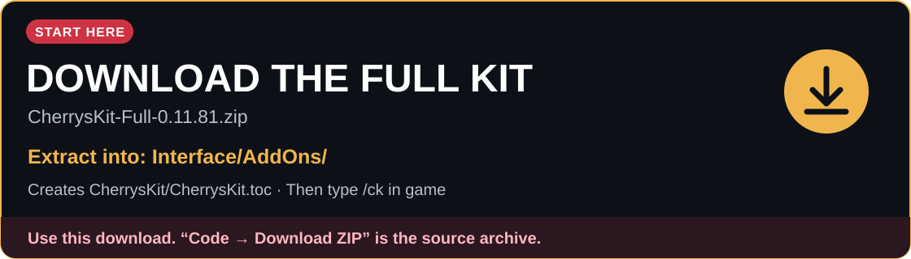

[](https://github.com/Cherrybooze/Cherrys-Kit/releases/download/v0.11.108/CherrysKit-Full-0.11.108.zip)

# Cherry's Kit

> Playtest build: kit **0.11.108**. Native-client checks are listed in [TESTING.md](docs/TESTING.md). The [latest stable build](https://github.com/Cherrybooze/Cherrys-Kit/releases/latest) is available separately.

## [Download the full kit — install ZIP](https://github.com/Cherrybooze/Cherrys-Kit/releases/download/v0.11.108/CherrysKit-Full-0.11.108.zip)

**Extract this ZIP straight into your game's `Interface/AddOns/` folder.** It creates `Interface/AddOns/CherrysKit/CherrysKit.toc`. Start the game or Reload UI, then type `/ck`.

> **Installing the addon? Use the download above.** GitHub's green **Code → Download ZIP** button and **Source code (zip)** links download the repository, with an extra `Cherrys-Kit-main` or version folder. Those downloads are for working on the source.

**Runes of Magic addons that work together, with one small control hub.**

Current playtest build: **0.11.108** · [Release notes and all downloads](https://github.com/Cherrybooze/Cherrys-Kit/releases/tag/v0.11.108)

Cherry's Kit combines original addons, rewrites and fixes to older favourites into a single collection. Pick the full kit, or install the hub and the addons you want. The hub opens their settings, turns them on or off after Reload UI, and gives them one place on your minimap.

## What’s new in 0.11.108

- **Emoji in Say bubbles**: **Cherry's Chat 0.11.0** sends emoji in Say as symbols the game font can draw (♥ ★ (^_^)), or as text like `:carrot:` when there is no symbol, so the bubble over your head shows them instead of two empty boxes. The game draws bubbles itself, so no addon can put pictures in them; Cherry's Chat users still see pictures in chat. Pick the style with **Say bubbles** in `/cchat`.

## In 0.11.107

- **Global Bank 1.4.11**: The extension's page has a Currencies tab with every character's currencies, totals and a sort per currency. The Bank tab can exclude items, with an option to exclude bound items that can't be equipped, and an always-keep list. Characters save their currencies and which items are bound the next time they log in.
- **Global Bank 1.4.10**: The auction cache now removes an item when its auction ends, not only after two days, and forgets old transfer records. The page also handles a character file of any size, for players with thousands of alts.
- **Global Bank 1.4.9**: The Bank tab can now run without the local helper: choose your save folder, and your game folder for icons, and it reads them straight from there. The Terminal and Auctions tabs still need the helper.
- **Global Bank 1.4.8**: the Daily Rewards extension's page shows everything your characters hold in one grid with search and filters, using the game's own icons, and runs the helper's commands. Viewing your bank no longer needs a terminal window.

## In 0.11.101

- **Real time for addons.** The hub has a clock now, fed by Global Bank's Daily Rewards Chrome extension 1.0.9, and **Cherry's Bar 1.1.8** and **ZShop 1.2.0-ck5** read it. Chrome starting is enough; it lasts until Windows restarts.

- **Global Bank 1.4.7**: the daily reset follows 00:00 in Germany in any time zone, and the extension's setup takes one click plus Chrome's two.

- **New separate packages:** [Cherry's Loginxml](Interface/AddOns/CherrysLoginxml/README.md), a replacement login screen that gets past a stuck server list, and [LogNextChar](Interface/AddOns/LogNextChar/README.md), Next and Prev character buttons.

- **Installing only some addons** no longer lights the minimap's bug button. Each addon is tested with only the hub, on a simulated client.

## In 0.11.100

- **rom weakauras 0.9.30**: dragging the corner at an aura's bottom right scales it again, and the arrows at its top left move it. Before this the game gave those grips no mouse scripts, so they did nothing. Shift-drag on an aura also scales it.

- **Cherry's Bar 1.1.7** (`/cbar`) is new: full-width information bars at the top of the screen, the bottom, or both, with nineteen displays set per bar. Its Kitty mode display replaces KittyCombo 1.7.17's "Mode:" plate. Drag displays on a map of the bars or on the bars themselves. Its bar styles and icons are Cherry's Studio Panel art. It is a fork of XBar III, with bars and right-click settings in the spirit of Titan Panel. It shows the top bar at first, drawn under the game's portrait, housing controls and minimap. A bottom bar lifts the whole interface and fits underneath. Hub 0.4.23 lists it. None of it has run in the game client yet, and [the checks are here](docs/TESTING.md).

## In 0.11.90

- **Names from chat into the mail**: with the mail window open, Ctrl+click or Shift+click a player's name in chat to put it in To. **Ultimate Mail Mod 7.0.1-ck10** fills Compose's To (switching to Compose from the inbox or History) or the mass-send To field on Mass Send Items, and **Cherry's Chat 0.10.12** hands these clicks to the mail window first.

## In 0.11.89

- **Cherry's Chat 0.10.11**: the right-click menu (Copy line, Copy name, Whisper, Add friend, Ignore) opens just right of the chat window's scroll bar, level with the middle of the window, instead of at the mouse, where it could hang below the bottom of the screen. With no room on the right it opens on the window's left.

## In 0.11.88

- **rom weakauras 0.9.29**: much shorter share codes (`RWA5!`), made like KittyCombo's CKC3 codes with a codebook every player has. An aura made from a template is about 20 to 45 characters instead of 450 to 1000, so most single auras fit in a chat line. Import also finds a code inside pasted text, and older codes still import.

## In 0.11.87

- **No work on every frame.** No kit addon does its work on every frame any more unless you are moving, sizing, sorting or selecting something. **rom weakauras 0.9.28** makes about 98% less garbage per second (about 4.6 MB down to 90 KB every 10 seconds with 15 buffs and 6 debuffs), and **pbInfo**, **Ultimate Mail Mod**, **zBag**, **Cherry's Grid** and **KittyCombo** check a few times a second instead.
- **Cherry's Chat 0.10.10**: no more freeze when many lines arrive at once, such as after raising a skill to its maximum and confirming, and a working scroll bar made from the game's own scroll parts.
- **rom weakauras 0.9.28**: the corner at an aura's bottom right scales it without a key, and the Position section is open. **Target health** shows the percentage above the bar and the HP number inside it, learned the way pbInfo does it (`?` until known).
- **Ultimate Mail Mod 7.0.1-ck9**: gold presets stop at 999,999,999 and get commas while you type, and **Forget own chars** asks Yes or No first.
- **Addon LoadTimes 1.3.0** is a troubleshooting addon now: it comes switched off in `LoadTimes/Switch.txt` and then uses no memory. The hub no longer bundles it.

## Also in this playtest

- **Cherry's Quests 1.0.0** (from 0.11.86): a prettier quest tracker. Ctrl+click a quest to cycle through the NPCs it names and track one.
- **KittyCombo 1.7.15** (from 0.11.85): the mode pictures open even while the mode button is hidden, two **Change kitty mode** rows can no longer flip the mode on every key press, and `/kc window 0.6` tries the older ready window.
- **KittyCombo**: a mode picker with pictures for the mode button, the "Mode:" readout and the **Change kitty mode** action, with pages when you have many modes. The mode button sits a little lower to clear the housing controls.
- **rom weakauras**: clickthrough auras (untick **Make clickthrough** to get an aura's tooltip back), a Scale setting for whole auras, optional scaling with your screen size (off by default), **Reset position**, and cast bars for transport books and other casts that are not spells.
- **Ultimate Mail Mod**: drag a box to select items across all six bags, a **Recently sent** list beside Mass Send, **Use last** and gold buttons, and a **History** tab with your last 20 recipients, shared by all your characters. Clicking an item keeps the cursor in the To field.
- **zBag**: the split-stack box stays open when your bags update, and slot numbers are smaller by default with a **Font size** setting in /zb.
- **Advanced AuctionHouse**: reads items with its own hidden tooltip instead of borrowing the game's upgrade tooltip.
- [Emoji pictures above players' heads](docs/CHAT_BUBBLES.md) are still not possible: the game gives addons no way to draw them.

Some features still need confirmation in the game client; see the release notes and individual addon guides for details.

## Why this project exists

Runes of Magic has plenty of useful addons, but many were made years ago and have different interfaces, overlapping features or rough edges on the current client. This project brings the addons I use into one place, fixes problems I run into, and connects them where it helps: raid-frame clicks can run a KittyCombo rotation, and rom weakauras can display what that rotation will do next.

It is a personal hobby project, shared so other players can use it, learn from it and improve it. It is not a promise to maintain every old addon or support every client and server setup.

## Download and install

**[Download the full-kit install ZIP](https://github.com/Cherrybooze/Cherrys-Kit/releases/download/v0.11.108/CherrysKit-Full-0.11.108.zip)** · [Hub and individual addon downloads](https://github.com/Cherrybooze/Cherrys-Kit/releases/latest)

- **Full kit:** the install ZIP above includes the hub and every addon.
- **Choose your addons:** download the Hub ZIP and whichever addon ZIPs you want from the release assets.

Extract the selected ZIPs into your game's **`Interface/AddOns/`** folder. They all contain a top-level `CherrysKit/` folder: merge those folders, keeping `CherrysKit.toc` directly inside `CherrysKit/`. Start the game or Reload UI, then type **`/ck`** (or **`/rwa`**).

The resulting layout should be:

```text
Interface/
  AddOns/
    CherrysKit/
      CherrysKit.toc
      CherrysKit.lua
      KittyCombo/
      RomWeakAuras/
      ...
```

If you already downloaded `Cherrys-Kit-main.zip`, use the install ZIP linked above instead. If Windows offers an extraction folder named after the ZIP, change that destination to your existing `Interface/AddOns/` folder.

Remove old separate copies of the same addons from `Interface/AddOns/` first; the hub keeps its copy idle if another copy is detected. Your saved settings live outside the addon folders. The [hub README](Interface/AddOns/CherrysKit/README.md) explains this in more detail.

**Addon LoadTimes** is a troubleshooting addon with its own ZIP. It comes switched off in its `LoadTimes/Switch.txt` and then uses no memory. Every individual addon ZIP requires the hub.

## What's included

| Addon | What it does | Command | Version |
| --- | --- | --- | --- |
| [Cherry's Kit hub](Interface/AddOns/CherrysKit/README.md) | Shared settings launcher, on/off switches and minimap button. | `/ck`,`/rwa` | 0.4.24 |
| [Cherry's KittyCombo](Interface/AddOns/CherrysKit/KittyCombo/README.md) | One-key priority combos and shared rotation codes. | `/kc` | 1.7.17 |
| [rom weakauras](Interface/AddOns/CherrysKit/RomWeakAuras/README.md) | Custom buff, debuff, cooldown, cast and status displays. | `/wa` | 0.9.30 |
| [Cherry's Chat](Interface/AddOns/CherrysKit/CherrysChat/README.md) | Selectable chat, copying, emoji and chat display settings. | `/cchat` | 0.11.0 |
| [zBag](Interface/AddOns/CherrysKit/zBag/README.md) | Bags, searching, sorting, quick sell and an All bags view. | `/zb` | 5.07-ck16 |
| [Global Bank](Interface/AddOns/CherrysKit/GlobalBank/README.md) | A searchable view of your characters' bags, banks and gold. | `/gb` | 1.4.11 |
| [Extended Macro Icons](Interface/AddOns/CherrysKit/ExtendedMacroIcons/README.md) | A larger, categorised macro icon picker. | `/emi` | 3.0.4 |
| [TooltipIds](Interface/AddOns/CherrysKit/TooltipIds/README.md) | ID numbers for items, buffs, skills and other game data. | `/ti` | 1.0b3-ck3 |
| [Ultimate Mail Mod](Interface/AddOns/CherrysKit/UltimateMailMod/README.md) | Mail management, drag-box selection, shared recipients, gold presets and mass sending. | `/umm` | 7.0.1-ck10 |
| [Advanced AuctionHouse](Interface/AddOns/CherrysKit/AdvancedAuctionHouse/README.md) | Auction searching, stat filters, history and a resizable window. | `/aah` | 6.2.5 |
| [Cherry's Addon LoadTimes](Interface/AddOns/CherrysKit/LoadTimes/README.md) | Troubleshooting: loading times and memory use, off until its Switch.txt turns it on. | `/ckload` | 1.3.0 |
| [ZShop](Interface/AddOns/CherrysKit/ZShop/README.md) | Item-shop access and a daily loyalty reward shortcut. | `/zshop` | 1.2.0-ck5 |
| [pbInfo](Interface/AddOns/CherrysKit/pbInfo/README.md) | Richer tooltips, quest tracking, chat filters and cast-bar options. | `/pbinfo` | 0.60-ck5 |
| [PortraitHP](Interface/AddOns/CherrysKit/PortraitHP/README.md) | Your target's health percentage on its portrait. | `/php` | 2019.07.14-ck2 |
| [Cherry's Grid](Interface/AddOns/CherrysKit/CherrysGrid/README.md) | Party and raid frames, with KittyCombo actions on click. | `/grid` | 1.1.4 |
| [Cherry's Quests](Interface/AddOns/CherrysKit/CherrysQuests/README.md) | A prettier quest tracker; Ctrl+click a quest to track the NPCs it names. | `/cq` | 1.0.0 |
| [Cherry's Bar](Interface/AddOns/CherrysKit/CherrysBar/README.md) | Information bars at the top, bottom or both, with displays set per bar. | `/cbar` | 1.1.8 |

Some integrations need both addons: for example, running a kitty from Grid needs KittyCombo. Each addon's README lists its requirements and current limits. Features still being tested are labelled there.

## Separate packages

These aren't in the full kit. Each is its own folder in `Interface/AddOns/`, and both need the hub.

| Package | What it does | Command | Version |
| --- | --- | --- | --- |
| [Cherry's Loginxml](Interface/AddOns/CherrysLoginxml/README.md) | A replacement login screen: gets past a stuck server list, saved logins, keyboard controls. Run its `Install login screen.bat` once. | | 1.2.0 |
| [LogNextChar](Interface/AddOns/LogNextChar/README.md) | Next and Prev buttons that log you straight into the neighbouring character. Needs Cherry's Loginxml. | `/lnc` | 1.2.0 |

## Optional Chrome extension

[Download Global Bank Daily Rewards for Chrome 1.0.13](https://github.com/Cherrybooze/Cherrys-Kit/releases/download/v0.11.108/CherrysKit-GlobalBankDailyRewards-1.0.13.zip) — an optional, separate Windows package for Chrome. It collects available rewards on the Gameforge daily shop page, records confirmed collections locally, and provides local character and auction-cache search. It requires Global Bank and its helper.

Extract the extension ZIP into `Interface/AddOns/`, run **Install Chrome extension.bat** from `CherrysKit/GlobalBank/Helper/`, and follow the [step-by-step setup guide](extras/GlobalBankDailyRewards/README.md). Chrome requires a one-time **Load unpacked** step. Automatic page processing is limited to the Gameforge daily shop page; the extension does not send your local data to the developer.

## Support and pull requests

Support and PR reviews are **best effort**. This is a small personal project; there is no promised response time, release schedule, or guarantee that every request will be taken on.

**Feel free to tweak it for your own setup.** If you think you fixed something that was broken, open a pull request. Keep it focused, explain what was wrong and what changed, and include what you tested in game. **Ideally DM me, cherry, on the Runes of Magic Discord about it too**, I may not notice a GitHub notification quickly.

Bug reports are welcome as well: say which addon and kit version you use, what you expected, what happened, and how to reproduce it. Add relevant probe output or screenshots when useful; the addon README gives the exact command. See [CONTRIBUTING.md](CONTRIBUTING.md) for a short guide.

## Inside this repository

- [`Interface/AddOns/CherrysKit/`](Interface/AddOns/CherrysKit/) holds the installed addon tree, with a README in the hub and every addon folder.
- [`docs/curseforge/`](docs/curseforge/README.md) contains the copy-and-paste CurseForge descriptions and publishing notes.
- [`docs/RELEASING.md`](docs/RELEASING.md) explains packaging, installation layouts and publishing a version.
- [`release-packages.json`](release-packages.json) records the package names and versions.
- [`tools/build_release.py`](tools/build_release.py) creates the ZIPs, validates their contents and writes SHA-256 checksums.

All addon source lives on **`main`**. Use short-lived branches for changes and tags for releases. Generated ZIPs live in Releases rather than Git history.

## Development and checks

Python 3.10 or later is enough; there are no Python package dependencies:

```sh
python tools/build_release.py
```

This creates nineteen ZIPs in `dist/<kit version>/` (the full kit, hub, sixteen addons and the optional Chrome extension), plus a release manifest, checksums and release notes. The same check runs on pushes and pull requests. It verifies the packaged source, file references, archive structure and local documentation links.

The original 0.11.77 import preserved the supplied runtime code. Earlier READMEs referring to old tests or generators are kept as reference notes, but those development tools were not included in the handoff. Current tests simulate client APIs; native drawing, input, sound and event timing still need in-game checks.

The current fixes also have Lua 5.1 regression coverage: install `tests/requirements.txt`, then run `python -m unittest discover -s tests -p 'test_*.py' -v`. The [in-game check list](docs/TESTING.md) describes the remaining native-client checks.

## Credits and licences

This collection includes work by several addon authors and bundles several different licences. Keep the individual credits, notices and media licences with anything you redistribute. [LICENSE.txt](LICENSE.txt) preserves the original combined notice file; the package READMEs explain the relevant origins, and each addon ZIP includes a copy.

The original [0.11.77 bundle README](docs/reference/CherrysKit_README-0.11.77.txt) is retained for reference.
